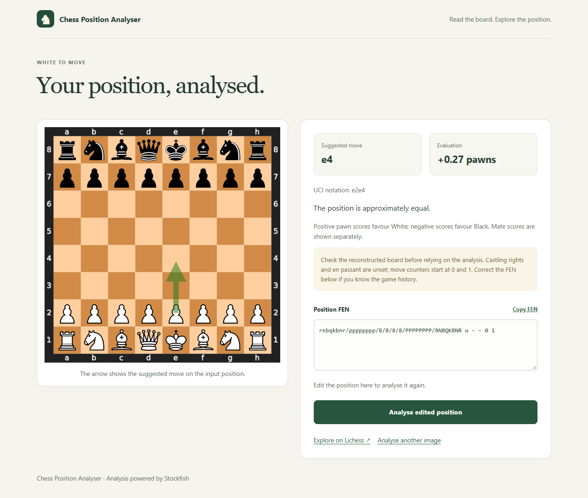

# Chess Position Analyser

A Flask app for analysing chess positions from screenshots and 2D board images.
Upload a board, choose whose turn it is, and get a suggested move and evaluation
from Stockfish. The position is also available as FEN for further analysis.



## Using the app

1. Upload a PNG, JPEG, or WebP image of a chessboard.
2. Select whose turn it is and which side is at the bottom of the image.
3. Click **Analyse position**.

The results show the reconstructed board, a suggested move with an arrow, and
Stockfish's evaluation. Positive scores favour White and negative scores favour
Black. Forced mates are displayed separately.

You can edit or copy the detected FEN, analyse a FEN directly, or open the position
on Lichess. Full FEN input also lets you specify castling rights, en passant, and
move counters.

## How it works

The image passes through two models before reaching Stockfish:

- **Board detection:** YOLOv8s locates the chessboard and supplies its crop.
- **Piece recognition:** the crop is converted to grayscale, resized to 320x320,
  and split into 64 squares. A PyTorch CNN assigns each square one of 13 classes:
  the six piece types for each colour, or empty.
- **Position analysis:** the predictions are converted to FEN and checked for
  chess consistency. Stockfish searches the position for a suggested move and
  provides its evaluation.

## Data generation and model training

Both models use synthetic chessboard data with automatically generated labels.

### Generating the data

Positions are created by starting from the initial board and playing 10-80 random
legal plies. Each position is rendered as a 400x400 image using python-chess, with
varied light and dark square colours. The piece-placement FEN is stored in the
filename and supplies the labels for all 64 squares.

For board detection, these images are resized to 100-500 pixels and placed at
random locations on 512x512 grayscale canvases. Background colours and surrounding
strips vary between images. The placement coordinates provide the bounding-box
annotations for the single `chessboard` class.

The generator is in [`training/generate_data.py`](training/generate_data.py).

### Piece classifier

The classifier has two convolution, ReLU, and max-pooling blocks, with 16 and 32
output channels, followed by a linear layer with 13 outputs. Training uses cross
entropy loss and Adam with a learning rate of 0.001. A batch of 64 boards supplies
4,096 labelled squares. The app uses 40x40-pixel square inputs.

The model definition is in
[`flask_app/models/cnn_model.py`](flask_app/models/cnn_model.py), and the training
logic is in [`training/train_classifier.py`](training/train_classifier.py).

### Board detector

YOLOv8s is fine-tuned from pretrained weights to detect the board as a single
object, using 512x512 images and a batch size of 32. The detector identifies the
board boundary; the separate CNN recognises the pieces inside it.

The training logic is in [`training/train_detector.py`](training/train_detector.py).
Stockfish handles chess evaluation and move search after recognition.

## Run locally

Python 3.10 or newer is needed. From the repository root:

```bash
python -m venv .venv
```

Activate the environment with `.venv\Scripts\activate` on Windows, or
`source .venv/bin/activate` on macOS/Linux, then run:

```bash
pip install -r requirements.txt
python -m flask_app
```

Open **http://127.0.0.1:5001**. The included
[example board](flask_app/static/example-board.png) shows the starting position;
select White to move and White at the bottom when uploading it.

The model weights and engine binaries are in `flask_app/essentials/`. The app uses
Stockfish from PATH when available, otherwise the bundled x86-64 Windows/Linux
executable. Set `CHESS_STOCKFISH_PATH` to use another compatible build.

On Linux, the bundled engine may need executable permission:

```bash
chmod +x flask_app/essentials/stockfish-ubuntu-x86-64-modern
```

Configuration defaults are in `flask_app/config.py`. For example, in PowerShell:

```powershell
$env:CHESS_STOCKFISH_PATH = "C:\tools\stockfish.exe"
$env:CHESS_ANALYSIS_TIME = "3.0"
```

## Project structure

```text
flask_app/        App, recognition pipeline, CNN, and Stockfish analysis
  templates/     Upload and results pages
  static/        Styles, image preview, and example board
  essentials/    Model weights and engine binaries
training/        Data generation and training scripts
examples/        Example analysis screenshot
requirements.txt
```

Built with Flask, PyTorch, Ultralytics YOLO, OpenCV, python-chess, and Stockfish.
Board graphics use the python-chess SVG piece set.
